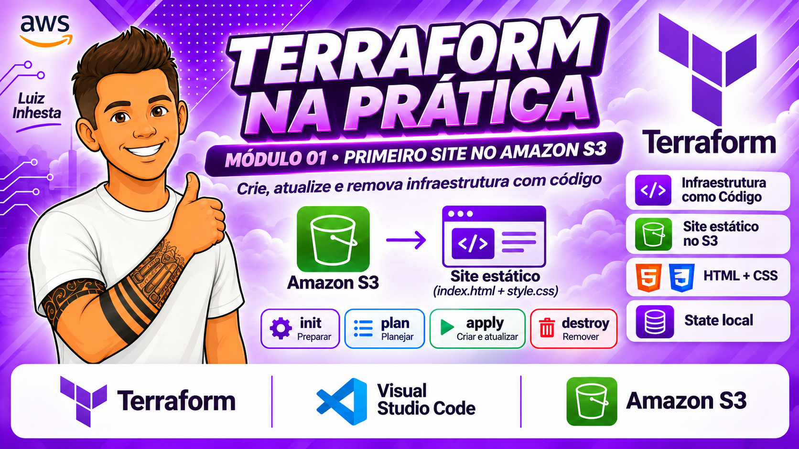
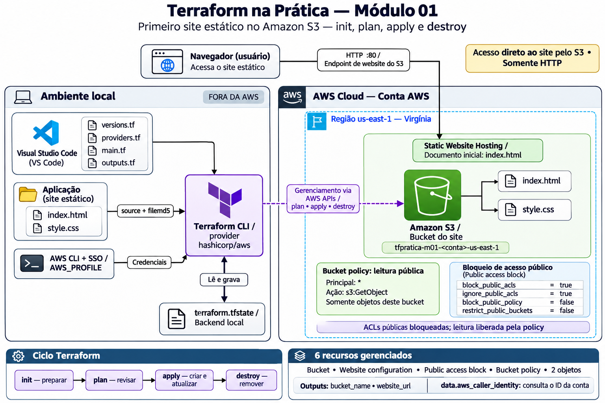

# Módulo 01 - Criando e destruindo um site estático no Amazon S3 com Terraform (init, plan, apply e destroy)



## Artigo: meu primeiro site com Terraform, do `init` ao `destroy`

> Módulo 01 da série **Terraform na Prática** · Etapa 1: Fundamentos

Se você já clicou em dezenas de telas do console da AWS para montar algo e, semanas depois, não lembrava mais o que tinha feito, este artigo é para você. Aqui eu publico um site estático no Amazon S3 **sem abrir o console para criar nada**. Só escrevo código, rodo alguns comandos e deixo o Terraform fazer o resto. No final, destruo tudo e confirmo que não sobrou nada.

O foco é aprender Terraform. O site e o S3 são apenas o recurso real que permite ver a ferramenta trabalhando.

## Sumário

1. [O problema que o Terraform resolve](#1-o-problema-que-o-terraform-resolve)
2. [O que vamos construir](#2-o-que-vamos-construir)
3. [Pré-requisitos](#3-pré-requisitos)
4. [Estrutura do projeto](#4-estrutura-do-projeto)
5. [Passo 1: autenticar na AWS](#5-passo-1-autenticar-na-aws)
6. [Passo 2: `init`, `fmt` e `validate`](#6-passo-2-init-fmt-e-validate)
7. [Passo 3: `plan`, o ensaio antes da estreia](#7-passo-3-plan-o-ensaio-antes-da-estreia)
8. [Passo 4: `apply` e a infraestrutura nasce](#8-passo-4-apply-e-a-infraestrutura-nasce)
9. [Passo 5: conferindo o que foi criado](#9-passo-5-conferindo-o-que-foi-criado)
10. [Passo 6: mudando o site e reaplicando](#10-passo-6-mudando-o-site-e-reaplicando)
11. [Passo 7: `destroy` e a limpeza](#11-passo-7-destroy-e-a-limpeza)
12. [O que aprendi](#12-o-que-aprendi)
13. [Documentação do módulo](#13-documentação-do-módulo)

---

## 1. O problema que o Terraform resolve

Montar infraestrutura pelo console funciona, mas tem três problemas: é difícil repetir, não deixa histórico e ninguém revisa um clique. Com **Infrastructure as Code (IaC)** você descreve o **estado desejado** em arquivos de texto e a ferramenta faz a AWS ficar igual ao que foi descrito.

- **Repetível:** o mesmo código gera o mesmo resultado.
- **Versionável:** o histórico fica no Git.
- **Revisável:** você vê o plano antes de alterar qualquer coisa.

O ciclo de vida do Terraform, que percorremos neste artigo, tem quatro comandos principais: `init`, `plan`, `apply` e `destroy`.

## 2. O que vamos construir

Um site simples com dois arquivos (`index.html` e `style.css`) hospedado no S3 com Static Website Hosting.

```
Navegador --HTTP--> Endpoint de website do S3 --> Bucket S3 (index.html, style.css)
```

O Terraform vai criar **6 recursos**:

| Recurso Terraform | Função |
|---|---|
| `aws_s3_bucket.site` | Bucket que guarda o site |
| `aws_s3_bucket_website_configuration.site` | Habilita o Static Website Hosting |
| `aws_s3_bucket_public_access_block.site` | Libera política pública **só neste bucket** |
| `aws_s3_bucket_policy.site` | Permite leitura pública (`s3:GetObject`) |
| `aws_s3_object.index` | Envia o `index.html` |
| `aws_s3_object.style` | Envia o `style.css` |

Há também um `data "aws_caller_identity"`, que apenas **lê** o ID da conta para compor um nome de bucket único. Ele não cria nada.

Não há CloudFront neste módulo. O S3 Website entrega só **HTTP**, então o navegador vai avisar "Não seguro". Isso é esperado. O diagrama completo está em [docs/ARQUITETURA.md](docs/ARQUITETURA.md).

## Arquitetura



O detalhamento está em [docs/ARQUITETURA.md](docs/ARQUITETURA.md).

## 3. Pré-requisitos

- Terraform CLI 1.5 ou superior (`terraform version`).
- AWS CLI com perfil SSO configurado.
- Permissão para criar e excluir buckets, políticas e objetos S3.
- Região usada: `us-east-1`.

## 4. Estrutura do projeto

```
modulo-01-primeiro-site/
├── application/        # O site: index.html e style.css
├── terraform/          # versions.tf, providers.tf, main.tf, outputs.tf
├── docs/               # Conceitos, implantação, testes, exercícios, destruição, arquitetura
├── imagens/            # Capturas de tela do laboratório
└── README.md
```

O Terraform lê todos os `.tf` da pasta como se fossem um só. Dividir em `versions.tf`, `providers.tf`, `main.tf` e `outputs.tf` é só convenção para facilitar a leitura. Cada bloco está explicado em [docs/CONCEITOS.md](docs/CONCEITOS.md).

## 5. Passo 1: autenticar na AWS

Nenhuma credencial fica no código. O provider usa o perfil do AWS CLI:

```powershell
aws sso login --profile <seu-perfil>
$env:AWS_PROFILE = "<seu-perfil>"
aws sts get-caller-identity
```

O último comando confirma em qual conta o Terraform vai trabalhar. Faça sempre essa checagem antes de um `apply` ou `destroy`.

.png>)

## 6. Passo 2: `init`, `fmt` e `validate`

```powershell
cd terraform
terraform init
terraform fmt
terraform validate
```

- `init` baixa o provider `hashicorp/aws` (aqui, a versão 6.71.0) e cria o `.terraform.lock.hcl`, que fixa versão e hashes. Esse arquivo vai para o Git.
- `fmt` padroniza a formatação.
- `validate` confere sintaxe e referências **sem acessar a AWS**.

.png>)

Se você viu `Terraform has been successfully initialized!` e `Success! The configuration is valid.`, está pronto para a próxima etapa.

## 7. Passo 3: `plan`, o ensaio antes da estreia

```powershell
terraform plan
```

O `plan` compara o seu código com o que existe de fato e mostra o que seria feito, **sem alterar nada**. Aprender a ler essa saída é a habilidade mais valiosa do módulo.

.png>)

Repare em três detalhes:

- `Plan: 6 to add, 0 to change, 0 to destroy.` resume a mudança.
- O símbolo `+` indica criação. Os outros são `~` (alterar), `-` (destruir) e `-/+` (substituir).
- Valores como `bucket_name` e `website_url` aparecem como `(known after apply)`, pois só existirão depois da criação.

O aviso no final lembra que, sem `-out`, o Terraform não garante aplicar exatamente este plano. Para guardar o plano, use `terraform plan -out=tfplan`.

## 8. Passo 4: `apply` e a infraestrutura nasce

```powershell
terraform apply
```

O Terraform exibe o plano de novo e **pede confirmação**. Só o `yes` é aceito.

.png>)

Depois do `yes`, o resultado:

.png>)

Observe a ordem dos eventos no log. O bucket é criado primeiro (`Creation complete after 4s`). Só então o Terraform cria o public access block, a configuração de website e os objetos. A política do bucket vem por último. Você não definiu essa ordem em lugar nenhum. O Terraform a deduziu das **referências** entre os recursos (`aws_s3_bucket.site.id`), formando um grafo de dependências. A exceção é a política, que usa um `depends_on` explícito para esperar o bloqueio público ser ajustado.

Ao final aparecem os outputs:

```
bucket_name = "tfpratica-m01-<id-da-conta>-us-east-1"
website_url = "http://tfpratica-m01-<id-da-conta>-us-east-1.s3-website-us-east-1.amazonaws.com"
```

## 9. Passo 5: conferindo o que foi criado

Vale conferir com os próprios olhos. No console do S3, o bucket está lá:

.png>)

Com os dois objetos que o Terraform enviou:

.png>)

A hospedagem de site estático está habilitada, com o endpoint que apareceu no output:

.png>)

A configuração de hospedagem, com `index.html` como documento de índice:

.png>)

Na aba **Permissões**, o bloqueio de acesso público foi ajustado só neste bucket. As ACLs públicas continuam bloqueadas, mas a política pública é permitida:

.png>)

E a política concede apenas `s3:GetObject`, limitada aos objetos deste bucket:

.png>)

Por fim, abrir a `website_url` no navegador. A aba Rede do DevTools mostra `index.html` e `style.css` com status 200:

.png>)

Em uma execução rápida, o `terraform plan` seguinte deve responder `No changes`: a infraestrutura bate com o código.

## 10. Passo 6: mudando o site e reaplicando

Aqui o Terraform mostra por que é melhor que clicar. Eu alterei o título e as cores do site (nos arquivos `index.html` e `style.css`) e rodei `plan`:

.png>)

Dessa vez, `Plan: 0 to add, 2 to change, 0 to destroy.` O símbolo é `~ update in-place`, e o que mudou foi o `etag`. Cada objeto guarda o hash do arquivo local (`filemd5`). Mudou o arquivo, mudou o hash, o Terraform percebe. O bucket, a política e o resto não foram tocados.

.png>)

`Apply complete! Resources: 0 added, 2 changed, 0 destroyed.` Recarregando a página, o site novo aparece:

.png>)

A mesma infraestrutura, só os arquivos que mudaram foram reenviados. Esse é o poder de declarar o estado desejado.

## 11. Passo 7: `destroy` e a limpeza

Laboratório bom é laboratório que não deixa conta de luz. Antes de destruir, confira de novo a conta com `aws sts get-caller-identity`, depois:

```powershell
terraform plan -destroy
terraform destroy
```

.png>)

`Destroy complete! Resources: 6 destroyed.` Repare que a ordem é inversa à da criação: política e website primeiro, bucket por último. O bucket usa `force_destroy = true`, então o conteúdo é apagado junto. Isso é prático em laboratório, mas perigoso em produção.

Agora, a prova de que acabou. Abrindo a mesma URL de antes:

.png>)

`404 Not Found`, `Code: NoSuchBucket`. O site deixou de existir. Dois detalhes finais: o `terraform.tfstate` ficou com `"resources": []` e a busca do bucket pela CLI não retornou nada.

.png>)

## 12. O que aprendi

- O ciclo `init` → `plan` → `apply` → `destroy` é o coração do Terraform.
- O `plan` é seguro e informativo. Leia-o sempre antes de um `apply`.
- A ordem de criação vem das **referências** entre recursos, não da ordem do arquivo.
- O **state** (`terraform.tfstate`) é a memória do Terraform. Sem ele, o `destroy` não sabe o que remover.
- Alterar um arquivo local gera um `~ update in-place`, não uma recriação.
- Sempre confirme a conta com `aws sts get-caller-identity` antes de mudanças destrutivas.

Próximos passos da série: dependências em profundidade e `for_each` (módulo 02), variáveis e outputs completos (módulo 03) e state em detalhe (módulo 04).

## 13. Documentação do módulo

| Documento | Conteúdo |
|---|---|
| [ARQUITETURA.md](docs/ARQUITETURA.md) | Diagramas, componentes e decisões de arquitetura |
| [CONCEITOS.md](docs/CONCEITOS.md) | Blocos `.tf`, provider, resource, dependências, state |
| [IMPLANTACAO.md](docs/IMPLANTACAO.md) | Passo a passo com capturas de tela |
| [TESTES.md](docs/TESTES.md) | Checklist de testes e evidências |
| [EXERCICIOS.md](docs/EXERCICIOS.md) | Exercícios guiados e desafios |
| [DESTRUICAO.md](docs/DESTRUICAO.md) | Como destruir e conferir a limpeza |

> Este módulo é independente: tem state local próprio e não depende de nenhum outro. Custos de um laboratório curto tendem a ser muito baixos, mas **dependem da sua conta**. Destrua os recursos ao terminar.
