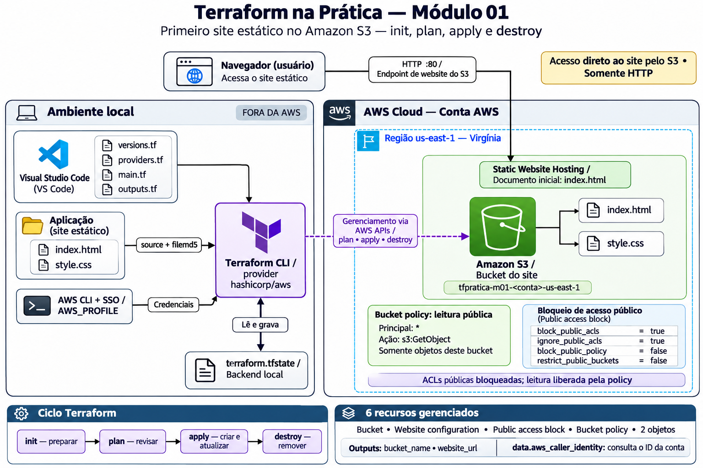
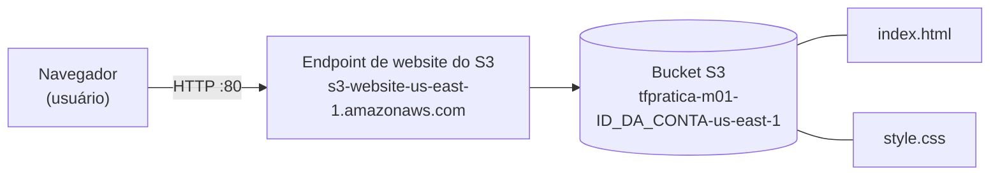
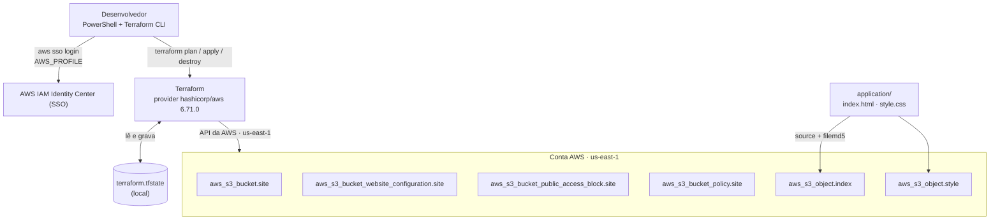
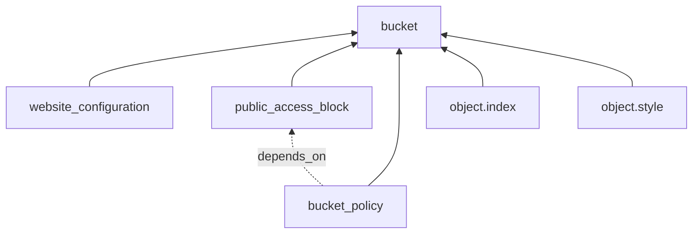
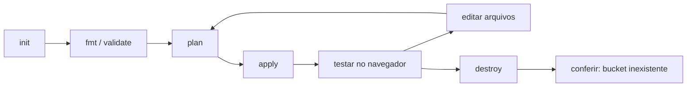

# Arquitetura — Módulo 01

Este documento descreve o que foi construído no laboratório: quais recursos existem na AWS, como eles se relacionam e como o Terraform os cria.

## Diagrama da arquitetura

## Visão geral

O usuário acessa o site pelo navegador, via HTTP. O endpoint de website do Amazon S3 entrega os arquivos `index.html` e `style.css` guardados em um único bucket. Não há CloudFront, domínio próprio nem HTTPS neste módulo.

## Arquitetura de implantação (quem cria o quê)

## Dependências entre os recursos

O Terraform monta um grafo a partir das referências. Setas indicam "depende de".

- Todos os recursos dependem do bucket (dependência **implícita**, pela referência `aws_s3_bucket.site.id`).
- A política depende também do `public_access_block` por `depends_on` **explícito**, pois a política pública só é aceita depois que `block_public_policy` é desligado.
- Por isso, nos logs do `apply`, o bucket é criado primeiro e a política por último.

## Componentes

| Componente | Recurso Terraform | Responsabilidade |
|---|---|---|
| Bucket | `aws_s3_bucket.site` | Guarda os arquivos do site. Nome: `tfpratica-m01-<id-da-conta>-us-east-1` |
| Website hosting | `aws_s3_bucket_website_configuration.site` | Habilita o endpoint de site estático e define `index.html` como documento de índice |
| Bloqueio de acesso público | `aws_s3_bucket_public_access_block.site` | Libera política pública **somente neste bucket**; ACLs públicas continuam bloqueadas |
| Política do bucket | `aws_s3_bucket_policy.site` | Permite `s3:GetObject` para `*` apenas nos objetos do bucket |
| Objetos | `aws_s3_object.index` / `.style` | Enviam `index.html` e `style.css`, com `content_type` e `etag` |
| Identidade da conta | `data.aws_caller_identity.current` | Lê o ID da conta para compor o nome único do bucket (não cria nada) |

## Decisões de arquitetura

| Decisão | Motivo | Limitação |
|---|---|---|
| S3 Website Hosting direto, sem CloudFront | Mantém o foco no Terraform e reduz recursos | Apenas HTTP; o navegador mostra "Não seguro" |
| Política pública só de leitura (`s3:GetObject`) | Princípio do menor privilégio dentro do necessário para um site público | Qualquer pessoa com a URL lê os arquivos |
| Public access block ajustado só no bucket | Não altera a configuração da conta inteira | Falha se a conta ou a organização bloquear acesso público (SCP) |
| `force_destroy = true` | Permite `terraform destroy` com objetos dentro | Em produção, apagaria dados sem aviso |
| State local | Simplicidade para o primeiro módulo | Sem trava compartilhada nem backup; backend remoto fica para etapas futuras |
| Credenciais via SSO e `AWS_PROFILE` | Nenhuma chave no código | Sessão expira e exige novo `aws sso login` |

## Ciclo de vida do laboratório

## Evidências do laboratório

O bucket criado, visto no console da AWS:

.png>)

Objetos dentro do bucket (`index.html` e `style.css`):

.png>)

Hospedagem de site estático habilitada e endpoint gerado:

.png>)

Política do bucket aplicada (leitura pública somente do laboratório):

.png>)

Para o passo a passo completo, veja [IMPLANTACAO.md](IMPLANTACAO.md). Para os conceitos por trás de cada bloco, veja [CONCEITOS.md](CONCEITOS.md).
